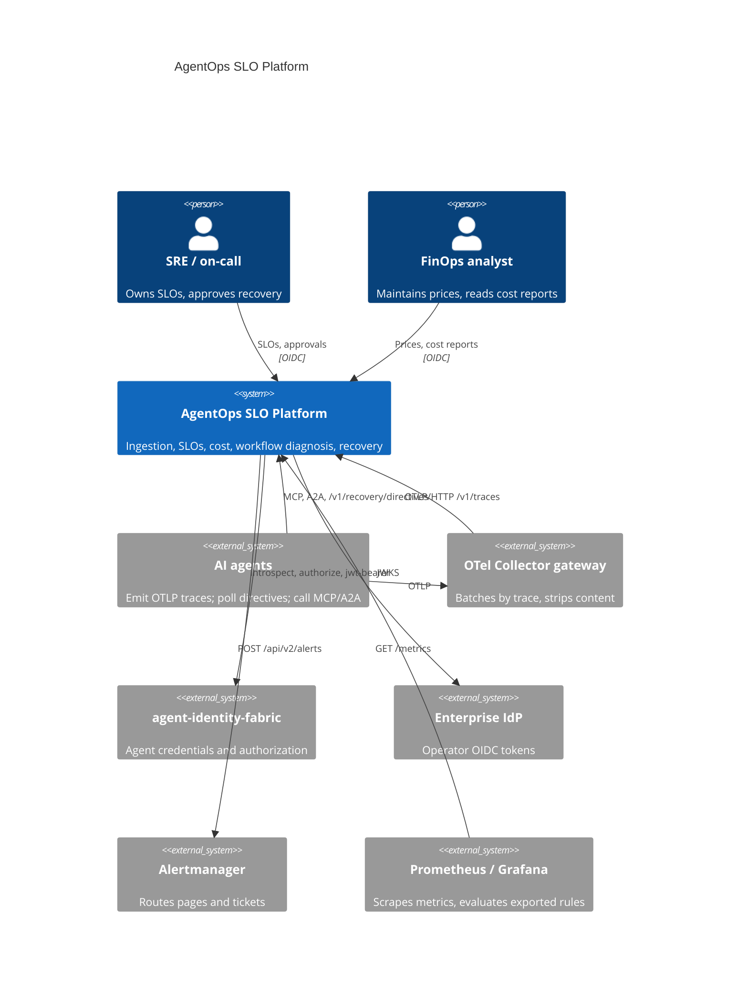
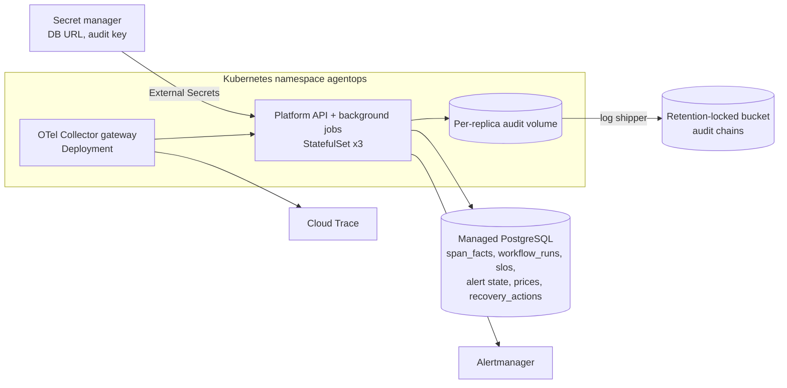
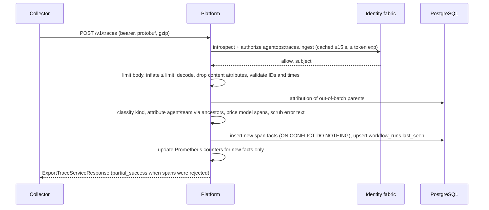
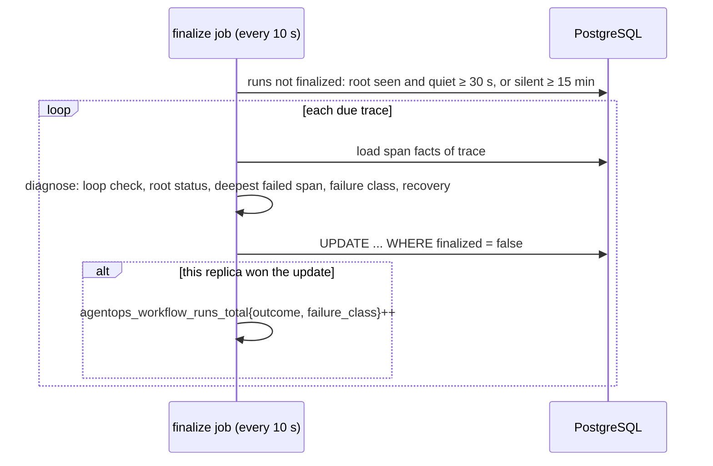
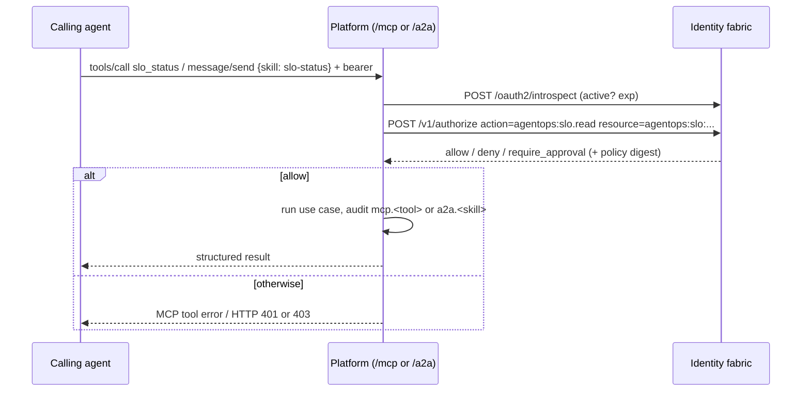
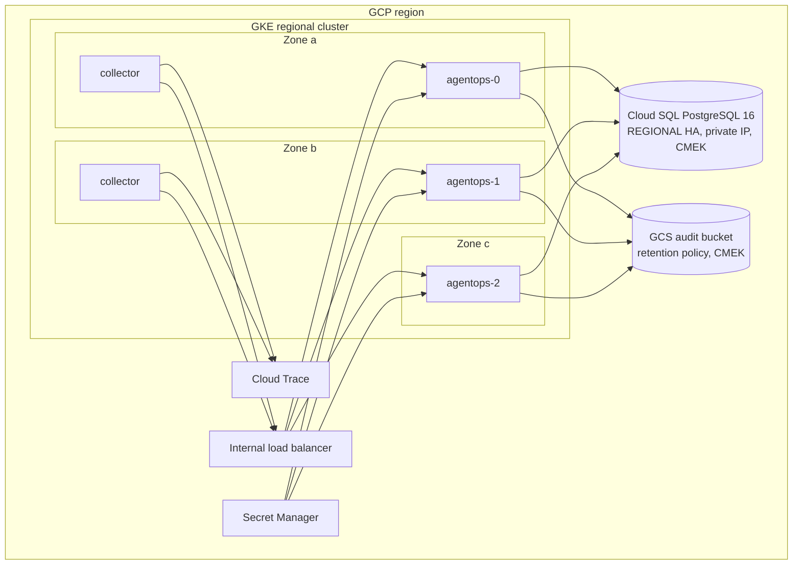

# Architecture

## Business problem

Agents fail differently from request/response services. A single user task
fans out into model calls, tool calls and memory lookups; a run can "succeed"
at the HTTP layer while a tool failed three times underneath, a model was
rate limited, or the agent looped until it hit an iteration cap. Spend is
driven by tokens rather than CPU, and it accrues to whichever team owns the
agent, not to the platform that hosts it. Operations teams need the same
things they have for microservices (SLOs, error budgets, paging that is
neither noisy nor late, cost allocation, a safe way to change runtime
behaviour) expressed in terms of agents, tools and workflows.

The platform consumes the telemetry agents already emit through
OpenTelemetry and turns it into those controls:

```
Task ─▶ Trace ─▶ Metrics ─▶ Cost ─▶ Recovery
```

## System context (C4 level 1)



## Containers (C4 level 2)



## Components (C4 level 3)

| Layer | Module | Responsibility |
|---|---|---|
| API | `api.routes`, `api.app` | HTTP contract, OTLP endpoint, operator authentication, correlation IDs, error bodies, `/mcp` route, background jobs |
| Ingestion | `ingestion.otlp` | Protobuf/JSON decoding, gzip with inflated-size limit, ID validation, content-attribute removal, OTLP responses |
| Ingestion | `ingestion.processor`, `ingestion.redaction` | Kind classification, attribution, pricing, scrubbing, idempotent storage, metrics |
| Application | `application.slo_service` | SLO CRUD and seeding, evaluation, alert state machine, Alertmanager notices, rule export |
| Application | `application.analytics` | Operation reports, cost reports, workflow finalization and diagnosis |
| Application | `application.recovery_service` | Recommendations, policy-gated actions, approvals, directives |
| Domain | `domain.spans`, `slo`, `workflows`, `recovery`, `costs` | Semantic-convention mapping, burn-rate math, classifier, retry/circuit derivation, price book |
| Integrations | `integrations.mcp_server`, `integrations.a2a` | MCP tools, A2A Agent Card and JSON-RPC |
| Security | `security.authz`, `admin`, `jwks` | Agent authorization (fabric or local), decision cache, operator roles, JWKS |
| Infrastructure | `infrastructure.database`, `fabric_client`, `notifier` | SQLAlchemy Core stores, identity fabric client, Alertmanager delivery |
| Observability | `observability.metrics`, `rules` | Prometheus exposition with cardinality limits, rule generation |
| Runtime | `runtime.container` | Composition root |

## Sequences

### OTLP ingestion and attribution



Storage failures return 503 with `Retry-After`, which OTLP exporters retry.
Because facts are keyed by (trace_id, span_id), a retried export never
double counts.

### Workflow finalization and classification



### SLO evaluation and Alertmanager notification

```mermaid
sequenceDiagram
  participant E as evaluate job (every 60 s)
  participant D as PostgreSQL
  participant A as Alertmanager
  E->>D: one aggregate query per SLO: total and bad events for 5m,30m,1h,2h,6h,1d,3d and the SLO window
  E->>E: burn = error ratio / (1 - objective); rule fires when long and short windows ≥ factor
  E->>D: conditional state transition (only the changing replica records the event)
  E->>E: audit slo.alert.firing / resolved
  E->>A: POST /api/v2/alerts (all firing, endsAt = now + 4 intervals; resolved once with endsAt = now)
```

### Recovery proposal, approval and directive

```mermaid
sequenceDiagram
  participant S as SRE or agent
  participant P as Platform
  participant S2 as Second SRE
  participant R as Agent runtime / gateway
  S->>P: POST /v1/recovery/actions {circuit.open, tool crm.lookup}
  P->>P: validate parameters and target kind; reject duplicates (409)
  P->>P: recovery policy: risk HIGH → require_approval
  P-->>S: 201 status=pending_approval (audited, policy digest)
  S2->>P: POST /v1/recovery/actions/{id}/approve
  P->>P: approver ≠ proposer; compare-and-set on status
  P-->>S2: status=active, expires = now + TTL (audited)
  R->>P: GET /v1/recovery/directives (agentops:directives.read)
  P-->>R: active directives
  R->>R: stop calling crm.lookup; probe after half_open_after_s
```

### MCP and A2A authorization



Without `AGENTOPS_FABRIC_URL` the platform verifies the JWT against
`AGENTOPS_AGENT_JWKS_URL` and evaluates `policies/agentops-access.yaml`
locally. There is no configuration in which agent calls are accepted
unauthenticated.

## MCP integration

The MCP server is built with the official `mcp` Python SDK (`MCPServer`) and
served over streamable HTTP at `/mcp` in stateless mode with JSON responses,
so every request is independent and any replica can serve it. Tool inputs
are typed function parameters with constraints (patterns, ranges, enums) and
outputs are Pydantic models, so `tools/list` publishes both input and output
schemas (committed in `docs/api/mcp-tools.json`). Each tool reads the bearer
credential from the HTTP request, authorizes it with its own scope, audits
the call and maps domain errors to MCP tool errors. Host-header checking
(DNS-rebinding protection) is enabled when `AGENTOPS_MCP_ALLOWED_HOSTS` is
set.

## A2A communication design

The Agent Card at `/.well-known/agent-card.json` declares protocol version
0.3.0, JSON-RPC transport, the five skills, and an HTTP bearer security
scheme. `POST /a2a` accepts JSON-RPC 2.0 `message/send`. A DataPart with a
`skill` key selects the skill; text-only messages are routed by fixed rules,
never by a model. Replies are completed (or failed) Tasks with a DataPart
carrying the structured result and a TextPart summary. Authentication is at
the HTTP layer (401/403); protocol errors use JSON-RPC codes (-32700,
-32600, -32601, -32602, -32005).

## Observability

The platform exposes `agentops_*` metrics on `/metrics` from its own
registry: ingestion (accepted by kind, duplicates, rejections by reason,
redactions), agent operations (`agentops_operations_total`,
`agentops_operation_duration_seconds`), tokens, cost, unpriced calls,
workflow runs and durations, SLO budget, burn rate and alert gauges, alert
transitions, recovery actions, authorization decisions, background job
failures, label overflow, and HTTP latency. Label values that come from
telemetry pass a per-label cardinality limiter (default 500 distinct values,
then `other`). The service's own traces go to OTLP when
`AGENTOPS_OTLP_ENDPOINT` is set; logs are JSON with correlation IDs. Alert
rules for the platform itself are in `configs/prometheus/alerts.yaml`; the
dashboard is `configs/grafana/agentops-slo-platform.json`.

## CI/CD

`.github/workflows/ci.yml`: quality on Python 3.12 and 3.13 (ruff, black,
mypy strict, bandit, contract drift, all test suites with a 90% coverage
gate), PostgreSQL integration tests against a service container, deployment
artifacts (helm lint and render, required-values failure check, kubeconform,
Terraform fmt and validate for three clouds, Trivy configuration scan),
container (build, smoke test, Trivy image scan, Syft SBOM, Grype gate) and
Semgrep. `release.yml` on `v*.*.*` tags re-runs the quality gate, checks the
tag against package and chart versions, pushes the image with provenance
attestation and the chart to GHCR, and publishes a GitHub release with the
SBOM.

## Deployment pattern

A StatefulSet (three replicas spread across zones) so each replica owns a
volume for its signed audit chain, shipped to retention-locked storage. All
other state is in PostgreSQL, so replicas are otherwise interchangeable and
background jobs run on every replica without leader election (see
ADR-0005). The OTel Collector runs as a separate gateway Deployment in front
of the platform: it groups spans by trace before export (so attribution
resolves within one batch), deletes content attributes a second time, and
fans out to the platform and the cloud trace backend.

## Deployment view (GCP reference)



Workload Identity binds the Kubernetes service account to a Google service
account that may only create objects in the audit bucket.

## Cloud reference implementation

| Concern | GCP (primary) | AWS | Azure |
|---|---|---|---|
| Kubernetes | GKE regional | EKS | AKS |
| Database | Cloud SQL PostgreSQL 16, REGIONAL | RDS PostgreSQL 16 Multi-AZ | PostgreSQL Flexible Server, zone-redundant HA |
| Encryption keys | Cloud KMS (90-day rotation) | KMS with rotation | Key Vault |
| Secrets | Secret Manager | Secrets Manager | Key Vault secrets |
| Audit storage | GCS with retention policy | S3 Object Lock (compliance) | Blob immutability policy |
| Workload identity | GKE Workload Identity | IRSA | Azure Workload Identity |
| Trace backend | Cloud Trace | X-Ray (collector exporter) | Azure Monitor (collector exporter) |

Terraform for all three lives in `deployments/terraform/{gcp,aws,azure}`.

## Data

| Store | Data | Classification | Retention |
|---|---|---|---|
| `span_facts` | One row per span: IDs, kind, name, agent, team, service, model, times, error type and scrubbed message, tokens, cost, caller | INTERNAL | `AGENTOPS_RETENTION_DAYS` (35, longer than the 30-day SLO window) |
| `workflow_runs` | Per trace: arrival, outcome, failure class, cost, diagnosis | INTERNAL | Same as spans |
| `slos`, `slo_alert_state`, `slo_alert_events` | Definitions, current rule state, transitions | INTERNAL | Life of the SLO; events kept |
| `prices` | Effective-dated rates, who set them | CONFIDENTIAL | Kept; past rates explain past costs |
| `recovery_actions` | Proposals, decisions, approvers, TTL | INTERNAL | Kept |
| Audit chains | Authorization decisions and state changes | CONFIDENTIAL | 7 years, retention-locked |

Prompt and completion content is never stored (dropped at decode).

## Cost and scalability

The write path is one indexed insert per span plus one upsert per trace per
batch. A span fact is a narrow row (fixed-width IDs, short labels, numeric
fields, an error message bounded to 512 characters only on failures), and
each of the five indexes on `span_facts` is keyed by a short label plus
`end_ns`, which matches every window query. SLO evaluation is one aggregate
query per SLO regardless of how many windows it covers, and its cost grows
with the number of events in the 30-day window.

Replicas are stateless apart from the audit volume, so ingestion scales by
adding replicas behind the collector; the database is the scaling limit. The
measures we would take, in order, as volume grows: partition `span_facts` by
day on `end_ns` so retention becomes a partition drop instead of a delete;
add per-minute rollups per (kind, name, agent, team) for windows longer than
a day so evaluation no longer scans raw rows; then sample successful spans
in the collector (tail sampling keeps all errors) and scale the SLI by the
sampling rate. These are deliberate next steps, not implemented in 0.1.0.

Spend on the platform itself is dominated by the database instance and
storage; it uses no model calls (ADR-0007).

## Acceptance criteria

| Criterion | Verified by |
|---|---|
| OTLP protobuf and JSON exports are accepted, malformed spans are reported as partial success | `tests/unit` (OTLP decoding), `tests/e2e` |
| Re-exported batches are not double counted | `tests/security::test_s11_duplicate_export_not_double_counted` |
| Content attributes never reach storage; error text is scrubbed | `test_s7`, `test_s8` |
| Model spans are attributed to the ancestor agent and team and priced at the effective price | `tests/unit` (processor, costs) |
| Burn-rate rules fire only when both windows exceed the factor and resolve when the short window recovers | `tests/unit` (SLO math), `tests/e2e` |
| Workflow outcomes and failure classes match the documented rules | `tests/unit` (workflows) |
| High-risk recovery actions are never active without a second person | `test_g2`, `test_g4` |
| Agent calls without valid credentials are refused on every interface | `test_s1`–`test_s4`, `test_g5`, `test_g6` |
| Dependency outages fail closed or degrade as documented | `tests/chaos` |
| Latency budgets for ingestion and evaluation hold | `tests/performance` |
| PostgreSQL behaviour matches SQLite | `tests/integration` |
| No API produces a 5xx for any schema-valid or invalid input | `tests/e2e` property-based OpenAPI test |
